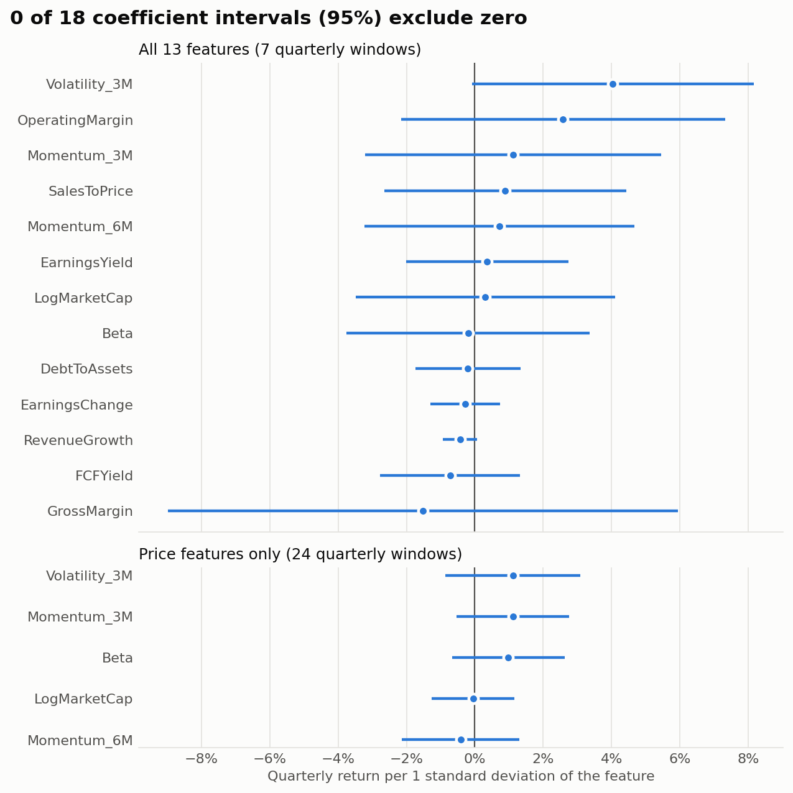
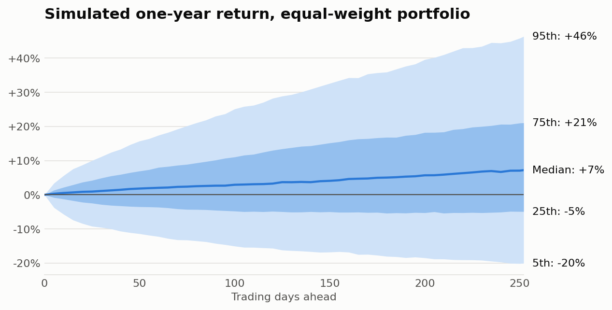

# StatStock

A learning project in applied statistics. It collects data on about 100 large US-listed companies from Yahoo Finance, stores it in MongoDB, and asks two questions:

1. **Can company characteristics predict next quarter's return?** Tested with regressions and out-of-sample evaluation.
2. **How much could a portfolio lose in a year?** Estimated with a correlated Monte Carlo simulation and checked against history.

**Main results** (data through 3 November 2026):

- No characteristic reliably predicts returns in this sample. The models explain 23–31% of returns within a quarter, but do worse than a no-signal benchmark out of sample.
- The simulated equal-weight portfolio has a one-year median return of +7% and a 5% VaR of −20%.
- In the backtest, the risk model's 5% VaR was breached 3.3% of the time for single stocks. It leans slightly cautious, but the result is consistent with 5%.

## Can characteristics predict returns?

Each quarter, every stock is compared with the others on the same 13 characteristics, covering profitability, leverage, growth, valuation, size, beta, momentum and volatility. A Fama-MacBeth regression fits one model per quarter and t-tests the average coefficient over time.



No coefficient differs significantly from zero, even before correcting for testing many features at once. Volatility comes closest in the 13-feature model (p = 0.054), but its interval still includes zero and it shrinks in the longer price-only sample.

Out of sample, each quarter is predicted using only coefficients from earlier quarters:

| Model | Quarters tested | R² in sample | R² out of sample | Mean rank correlation (IC) | IC t-stat |
|---|---|---:|---:|---:|---:|
| All 13 features | 4 | 30.7% | −5.0% | 0.00 | 0.01 |
| Price features only | 21 | 23.4% | −2.6% | −0.01 | −0.22 |

In-sample R² is the average of the per-quarter fits. A negative out-of-sample R² means the model did worse than predicting that every stock earns the average return. So the high in-sample R² mostly reflects fitting noise, and this is why out-of-sample evaluation matters.

An earlier version of this project reported operating margin as a significant predictor (p = 0.014). That result relied on today's valuation ratios, ignored reporting delays and used a smaller sample. It did not survive the corrections below (p = 0.23).

## How much could a portfolio lose?

All stocks are simulated together with a Merton jump-diffusion model: correlated daily moves, jumps specific to each stock, and market-wide jumps scaled by beta.



| One year, equal-weight portfolio | |
|---|---:|
| Expected return | +9.4% |
| Median return | +7.2% |
| 5% VaR (return at the 5th percentile) | −20.0% |
| 5% CVaR (average return below that) | −25.6% |

Expected return comes from CAPM with an assumed 4% risk-free rate and 5% equity premium. It is not estimated from recent performance, because a year of returns says almost nothing about expected return: at 30% volatility, the standard error is 30 percentage points. The regression signal can tilt this drift, but only if it passes an out-of-sample check. It currently doesn't, so no tilt is applied.

### Does the risk model hold up?

At 19 non-overlapping dates, the model was fitted on prior data and used to forecast the next 63 trading days. A breach means the realized return fell below the forecast 5% VaR, which should happen about 5% of the time.

| Model | Level | Forecasts | Breaches | Breach rate | 95% interval | Inside 90% band |
|---|---|---:|---:|---:|---:|---:|
| Jump diffusion | Single stocks | 2,013 | 67 | 3.3% | 1.4–5.8% | 92.0% |
| GBM baseline | Single stocks | 2,013 | 127 | 6.3% | 2.3–11.4% | 86.9% |
| Jump diffusion | Portfolio | 19 | 0 | 0% | n/a | 94.7% |
| GBM baseline | Portfolio | 19 | 2 | 10.5% | n/a | 84.2% |

Both models are consistent with a 5% breach rate, so this backtest cannot separate them. The single-stock intervals resample whole forecast windows, because stocks tend to breach together. With 19 windows, the portfolio test has little power (Kupiec p = 0.16 for jump diffusion and 0.33 for GBM).

## How the analysis avoids common errors

| Problem | What the code does |
|---|---|
| Using information before it was public | A quarter's results only count 45 days after quarter-end. In a sample of 50 companies, 98% of 153 earnings dates fell within that lag (median 25 days). |
| Today's values in historical rows | Beta, size and valuation ratios are recalculated for each date from prices and reported figures. |
| Comparing different time windows | All stocks use the same formation dates, and return windows do not overlap. |
| Coefficients on different scales | Features are winsorized and z-scored within each date, so a coefficient means return per 1 standard deviation. |
| Unadjusted stock splits | Incremental fetches compare overlapping prices with stored values and reload a ticker if Yahoo has readjusted it. |
| Testing many features | Fama-MacBeth p-values also get Benjamini-Hochberg q-values. Pooled OLS uses standard errors clustered by date. |
| Double-counting jumps | Jump-day moves are removed from the diffusion covariance, since the jump terms already model them. |

## Limitations

- **Survivorship bias.** The universe is companies listed today, so firms that failed or were bought out are missing. This likely flatters returns and understates risk.
- **Short fundamental history.** Yahoo serves about six quarters of fundamentals, which leaves 7 cross-sections and 4 out-of-sample quarters for the full model. The null result means "no evidence in this sample", not "no effect".
- **Approximate market values.** Historical market value uses today's share count, ignoring buybacks and issuance.
- **Approximations in the features.** Quarter-over-quarter growth contains seasonality. `EarningsChange` is a change in earnings, not a surprise against analyst estimates, because Yahoo's estimate history stops too early. P/B is left out because book equity can't be reconstructed far enough back, though it is now being collected.
- **Assumed reporting lag.** The 45 days is one rule for all companies, not each company's actual report date.
- **Slow-moving crash risk.** Market jump frequency comes from the full history, including 2020, so the model doesn't calm down in quiet periods. This is one reason it runs cautious.
- **Assumed drift.** The risk-free rate and equity premium are assumptions, not estimates.

This is not investment advice.

## Running it

Requires Python 3.11+ and MongoDB running locally on port 27017.

```bash
pip install -r requirements.txt

python main.py fetch      # download data from Yahoo Finance
python main.py analyze    # run all analysis steps and redraw the figures
python -m pytest          # run the tests (no database or network needed)
```

| Command | What it does |
|---|---|
| `fetch --mode 0` | Fetches everything (default) |
| `fetch --mode 1` | Fetches company snapshots only |
| `fetch --mode 2` | Fetches quarterly financials only |
| `fetch --mode 3` | Fetches prices only |
| `fetch --mode 3 --full` | Reloads all price history |
| `regression` | Runs the regressions and out-of-sample evaluation |
| `correlation` | Exports pairwise return correlations for Power BI |
| `monte-carlo` | Runs the simulation and backtest (run `regression` first) |
| `figures` | Redraws the README figures |

Results are written to MongoDB and to CSV files in `output/`. To use another database or folder, set `STATSTOCK_DB`, `STATSTOCK_OUTPUT` or `STATSTOCK_MONGO_URI`.

## Project structure

```
StatStock/
├── loadData/
│   ├── db.py               # MongoDB connection and settings
│   ├── load_yfinance.py    # Data fetching
│   ├── market_data.py      # Shared price loading and integrity checks
│   ├── mongo_helpers.py    # Upsert, merge and replace helpers
│   └── tickers.py          # Ticker lists
├── calculations/
│   ├── regression.py       # Point-in-time panel, OLS, Fama-MacBeth, walk-forward
│   ├── monte_carlo.py      # Jump-diffusion simulation and VaR backtest
│   ├── correlation.py      # Return correlations
│   └── figures.py          # README figures
├── docs/figures/           # Figures shown above
├── tests/                  # Tests on synthetic data
├── main.py                 # Command line entry point
└── requirements.txt
```

## Stack

Python, pandas, NumPy, SciPy, statsmodels, matplotlib, yfinance, MongoDB (pymongo), pytest, and Power BI for dashboards.
